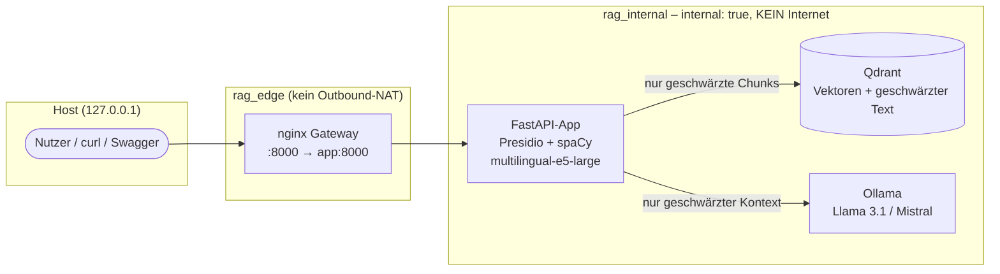

# DSGVO-konformes lokales RAG-System

[](https://github.com/amey000/dsgvo-local-rag/actions/workflows/ci.yml)


Retrieval-Augmented Generation über interne Dokumente – **vollständig lokal**, ohne Cloud-API, mit
**automatischer Schwärzung personenbezogener Daten vor der Vektorisierung**.

**Stack:** Python · Ollama (Llama 3 / Mistral) · Qdrant · Microsoft Presidio · spaCy ·
multilingual-e5-large · FastAPI · Docker

> *English summary:* A GDPR-compliant, fully local RAG pipeline. German PII (names, IBANs, phone
> numbers, addresses, tax IDs, …) is pseudonymised with Microsoft Presidio **before** anything is
> embedded, stored or sent to the LLM. Ollama and Qdrant run in an internal Docker network without
> internet access; answers are grounded in numbered, verifiable source citations.

---

## Features

- **Lokale RAG-Pipeline** – Ollama (Llama 3.1 8B oder Mistral 7B) und Qdrant laufen in einem
  isolierten Docker-Netzwerk (`internal: true`, kein Gateway ins Internet).
- **Schwärzung deutscher personenbezogener Daten** mit Microsoft Presidio *vor* der Vektorisierung:
  Namen (spaCy-NER `de_core_news_md`), IBANs (inkl. Prüfsumme), Telefonnummern (DE/AT/CH),
  E-Mail-Adressen, Straßenadressen, Steuer-ID (mit Prüfziffer), Rentenversicherungsnummer,
  Kreditkarten, IP-Adressen.
- **Konsistente Pseudonymisierung** – `Anna Schmidt` wird innerhalb eines Dokuments immer zu
  `<PERSON_1>`, sodass das LLM Zusammenhänge versteht, ohne die echten Daten zu sehen. Die Zuordnung
  wird nie gespeichert.
- **Vektorsuche mit `intfloat/multilingual-e5-large`** (1024 Dimensionen, Cosine) inkl. korrekter
  `query:`/`passage:`-Präfixe und kalibriertem Relevanz-Schwellwert.
- **Quellenbasierte, zitierfähige Antworten** – System-Prompt erzwingt Belege im Format `[1]`,
  Zitate werden geparst und validiert; nicht belegte Antworten werden markiert.
- **Recht auf Löschung (Art. 17 DSGVO)** – `DELETE /documents/{doc_id}` entfernt alle Vektoren
  eines Dokuments.
- REST-API (FastAPI, Swagger unter `/docs`) und CLI, 58 Tests, CI mit GitHub Actions.

## Architektur



### Datenfluss

```text
Ingestion:  PDF/MD/TXT ─► Text extrahieren ─► Presidio-Schwärzung ─► Chunking ─► e5 "passage:" ─► Qdrant
                                              (ganzes Dokument,       (1000 Zeichen,
                                               konsistente Labels)     150 Overlap)

Anfrage:    Frage ─► Presidio-Schwärzung ─► e5 "query:" ─► Top-k (Score ≥ 0.77) ─► Prompt mit [1]…[k]
                                                                │                     │
                                                       keine Treffer ─► "keine Info"   ▼
                                                       (LLM wird nicht aufgerufen)   Ollama ─► Zitate prüfen
```

Die Schwärzung passiert **vor** dem Chunking, damit die NER den vollen Kontext sieht und keine
Entität an einer Chunk-Grenze halbiert wird.

## Datenschutz-Konzept (Privacy by Design, Art. 25 DSGVO)

| Maßnahme | Umsetzung |
|---|---|
| Keine Drittland-Übermittlung | Kein Cloud-LLM, keine externe Embedding-API. Alle Modelle laufen lokal. |
| Netzwerkisolation | App, Qdrant und Ollama hängen nur am Netz `rag_internal` (`internal: true`). Nur der nginx-Gateway ist erreichbar – und nur auf `127.0.0.1`. Prüfbar mit `make verify-isolation`. |
| Offline-Betrieb | spaCy- und e5-Modell werden beim Build ins Image gebacken (`HF_HUB_OFFLINE=1`). Das LLM wird einmalig vom separaten Job `model-pull` geladen – dem einzigen Container mit Internetzugang, der keine Daten verarbeitet. |
| Datenminimierung | Presidio schwärzt PII **bevor** Text eingebettet, gespeichert oder an das LLM gegeben wird. Auch Fragen und **Dateinamen** (sie erscheinen in Zitaten) werden geschwärzt. |
| Keine Re-Identifizierung | Die Zuordnung Klartext → Platzhalter existiert nur im Arbeitsspeicher während der Verarbeitung eines Dokuments. Der System-Prompt verbietet dem LLM, Platzhalter aufzulösen. |
| Recht auf Löschung | `DELETE /documents/{doc_id}` bzw. `dsgvo-rag delete <doc_id>`. |
| Keine Inhalte in Logs | Die App loggt nur Metadaten (IDs, Anzahl Chunks, Entitätstypen); nginx-Access-Log ist deaktiviert; Telemetrie von Qdrant und Hugging Face ist abgeschaltet. |
| Container-Härtung | Non-root-User, `read_only`-Dateisystem, `no-new-privileges`, `cap_drop: ALL`, unprivilegiertes Qdrant-Image. |

### Erkannte Entitäten

| Entität | Erkennung | Platzhalter | Beispiel |
|---|---|---|---|
| Personennamen | spaCy NER (`de_core_news_md`) | `<PERSON_n>` | Jürgen Müller-Lüdenscheidt |
| IBAN | Muster + Prüfsumme (alle Länder) | `<IBAN_n>` | DE89 3704 0044 0532 0130 00 |
| Telefonnummer | `phonenumbers`, Regionen DE/AT/CH | `<TELEFON_n>` | 030 23125000, +49 171 2345678 |
| E-Mail | Muster + TLD-Validierung | `<E_MAIL_n>` | j.mueller@example.com |
| Adresse | eigenes Muster (Straße + Nr. [+ PLZ Ort]) | `<ADRESSE_n>` | Lindenstraße 14, 50674 Köln |
| Steuer-ID | eigenes Muster + ISO-7064-Prüfziffer | `<STEUER_ID_n>` | 86 095 742 719 |
| Rentenversicherungsnr. | eigenes Muster + Kontext | `<SV_NUMMER_n>` | 12 150485 M 123 |
| Kreditkarte, IP-Adresse | Presidio (Luhn-Prüfung) | `<KREDITKARTE_n>`, `<IP_ADRESSE_n>` | 4111 1111 1111 1111 |

Orte und Organisationen können zusätzlich über `RAG_PII_ENTITIES` aktiviert werden (standardmäßig
aus, da sie meist kein Personenbezug sind und die Antwortqualität verschlechtern).

## Schnellstart (Docker)

**Voraussetzungen:** Docker mit Compose v2, ca. 15 GB freier Speicher, ≥ 12 GB RAM für Docker
(Llama 3.1 8B). Mit weniger RAM `LLM_MODEL=llama3.2:3b` verwenden.

```bash
git clone https://github.com/amey000/dsgvo-local-rag.git
cd dsgvo-local-rag
cp .env.example .env          # optional: LLM_MODEL anpassen

make setup                    # Image bauen (inkl. spaCy + e5) und LLM einmalig herunterladen
make up                       # Stack starten → http://127.0.0.1:8000/docs
make verify-isolation         # prüfen, dass App/Qdrant/Ollama kein Internet erreichen
make ingest                   # fiktive Beispieldokumente aus data/samples indexieren
make ask Q="Wie viele Urlaubstage habe ich?"
```

### Beispiel

```bash
curl -s -X POST http://127.0.0.1:8000/redact -H 'Content-Type: application/json' \
  -d '{"text": "Herr Jürgen Müller (Tel. 0221 4710123) zahlt auf DE89 3704 0044 0532 0130 00."}'
```

```json
{
  "text": "Herr <PERSON_1> (Tel. <TELEFON_1>) zahlt auf <IBAN_1>.",
  "entities": {"PERSON": 1, "PHONE_NUMBER": 1, "IBAN_CODE": 1}
}
```

```bash
curl -s -X POST http://127.0.0.1:8000/query -H 'Content-Type: application/json' \
  -d '{"question": "Bis wann müssen Datenpannen gemeldet werden?"}'
```

Antwortstruktur (gekürzt; der Wortlaut der Antwort hängt vom Modell ab):

```json
{
  "answer": "Die Meldung an die Aufsichtsbehörde muss binnen 72 Stunden erfolgen [1].",
  "sources": [
    {"index": 1, "source": "datenschutzrichtlinie.md", "page": null, "score": 0.8471, "cited": true, "text": "..."}
  ],
  "redacted_question": "Bis wann müssen Datenpannen gemeldet werden?",
  "grounded": true,
  "model": "llama3.1:8b"
}
```

Eigene Dokumente: per `POST /documents` (Multipart, PDF/MD/TXT) hochladen oder nach `data/` legen
und `docker compose exec app dsgvo-rag ingest /data/<ordner>` ausführen. `data/` ist außer den
Beispielen per `.gitignore` ausgeschlossen.

## API

| Methode | Pfad | Beschreibung |
|---|---|---|
| `GET` | `/health` | Status von Qdrant und LLM |
| `POST` | `/redact` | Text schwärzen (Demo, nichts wird gespeichert) |
| `POST` | `/documents` | Dateien hochladen → schwärzen → indexieren |
| `GET` | `/documents` | Indexierte Dokumente (geschwärzter Name, Chunks, Zeitpunkt) |
| `DELETE` | `/documents/{doc_id}` | Alle Vektoren eines Dokuments löschen (Art. 17 DSGVO) |
| `POST` | `/query` | Frage stellen → Antwort mit Quellen `[n]` |

CLI im Container: `dsgvo-rag {ingest,query,redact,docs,delete,serve} --help`

## Lokale Entwicklung

```bash
make install                  # venv + Abhängigkeiten + spaCy-Modell
make test                     # 52 schnelle Tests (Presidio echt, Qdrant in-memory, Fake-LLM)
.venv/bin/pytest -m slow      # 6 Retrieval-Tests mit dem echten multilingual-e5-large (~2 GB)
make lint
```

Die Kern-Garantie ist als Test formuliert
([`test_no_raw_pii_reaches_vector_store_or_embedder`](tests/test_pipeline.py)): Nach dem
Indexieren der Beispieldokumente darf keine einzige der enthaltenen personenbezogenen Angaben im
Vektorspeicher, in den Embedding-Eingaben oder im LLM-Prompt auftauchen.

## Konfiguration

Alle Werte über Umgebungsvariablen mit Präfix `RAG_` (siehe [`.env.example`](.env.example)):

| Variable | Standard | Bedeutung |
|---|---|---|
| `LLM_MODEL` | `llama3.1:8b` | Ollama-Modell (`mistral:7b`, `llama3.2:3b`, …) |
| `RAG_EMBEDDING_MODEL` | `intfloat/multilingual-e5-large` | Embedding-Modell |
| `RAG_SPACY_MODEL` | `de_core_news_md` | spaCy-Modell für die NER |
| `RAG_PII_ENTITIES` | siehe oben | Zu schwärzende Entitätstypen (JSON-Liste) |
| `RAG_PII_SCORE_THRESHOLD` | `0.35` | Mindest-Konfidenz für eine Schwärzung |
| `RAG_PII_ALLOW_LIST` | `[]` | Begriffe, die nie geschwärzt werden (z. B. Firmenname) |
| `RAG_REDACT_QUERIES` | `true` | Auch Fragen vor der Suche schwärzen |
| `RAG_CHUNK_SIZE` / `RAG_CHUNK_OVERLAP` | `1000` / `150` | Chunking in Zeichen |
| `RAG_TOP_K` | `5` | Anzahl Kontext-Chunks |
| `RAG_MIN_SCORE` | `0.77` | Cosine-Schwellwert; darunter wird das LLM gar nicht erst gefragt |

Der Schwellwert ist auf e5 kalibriert: Relevante Treffer liegen bei den Beispieldaten bei
0,82–0,86, themenfremde Fragen bei 0,72–0,77.

## Projektstruktur

```text
├── docker-compose.yml        # isolierte Netzwerke, Härtung, model-pull-Job
├── Dockerfile                # Multi-Stage, CPU-Torch, Modelle offline im Image
├── docker/nginx.conf         # Gateway (einziger veröffentlichter Port, nur 127.0.0.1)
├── scripts/verify_isolation.sh
├── src/dsgvo_rag/
│   ├── redaction/            # Presidio-Engine, deutsche Recognizer, Pseudonymisierung
│   ├── loaders.py            # PDF/MD/TXT
│   ├── chunking.py           # rekursiver Splitter mit Overlap
│   ├── embeddings.py         # multilingual-e5-large
│   ├── vectorstore.py        # Qdrant (idempotente IDs, Löschen pro Dokument)
│   ├── prompts.py            # System-Prompt, Zitat-Parsing
│   ├── llm.py                # Ollama-Client
│   ├── pipeline.py           # Ingestion + Query-Orchestrierung
│   ├── api.py / cli.py
├── tests/                    # 58 Tests
└── data/samples/             # fiktive Beispieldokumente mit Test-PII
```

## Grenzen und bewusste Trade-offs

- **NER ist nicht perfekt.** Statistische Namenserkennung hat keine 100 % Trefferquote, besonders
  bei ungewöhnlichen Namen oder Kleinschreibung. Für produktive Szenarien: größeres spaCy-Modell
  oder Transformer-NER, Allow-/Deny-Listen und Stichproben-Audits über `POST /redact`.
- **Fragen zu konkreten Personen sind absichtlich nicht beantwortbar.** Da Namen vor der
  Vektorisierung entfernt werden, findet „Welche IBAN hat Herr Müller?“ nichts – das ist
  Datenminimierung, kein Bug.
- **Leistung auf dem Mac:** Docker Desktop hat keinen Zugriff auf die Apple-GPU; Ollama läuft im
  Container auf der CPU (einige Tokens/s bei 8B-Modellen). Ein nativ installiertes Ollama wäre
  schneller, liegt aber außerhalb der Netzwerkisolation.
- Dieses Projekt ist eine technische Referenzimplementierung und keine Rechtsberatung. Eine
  Datenschutz-Folgenabschätzung (Art. 35 DSGVO) ersetzt es nicht.

## Lizenz

[MIT](LICENSE) – alle Personen, Kontaktdaten und Bankverbindungen in `data/samples` sind frei
erfunden.
